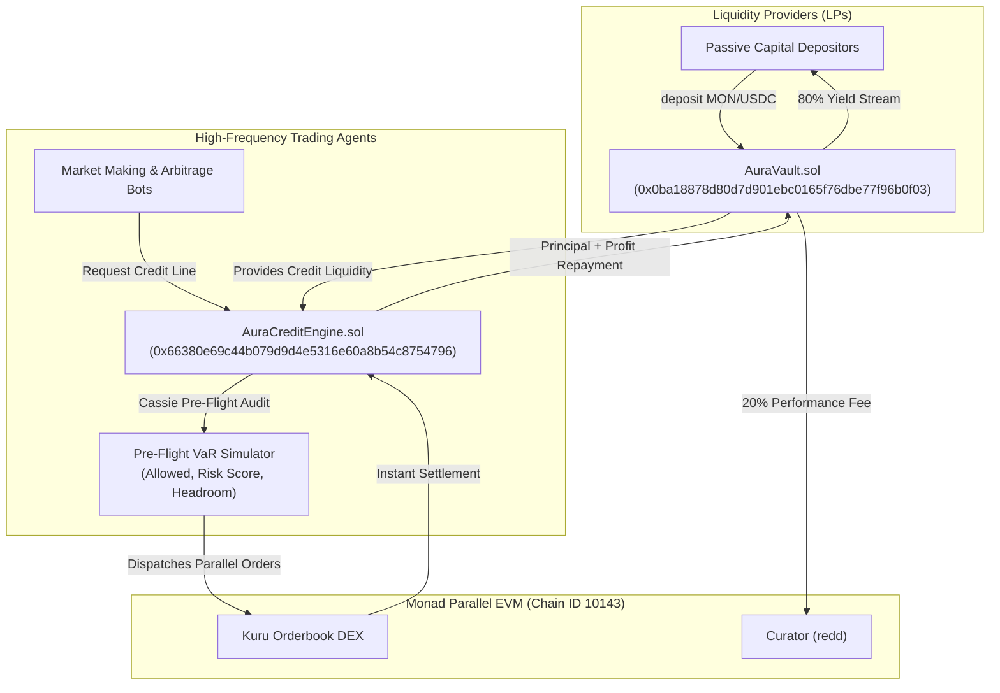

# AURA Vault Protocol · Metropolis Monad Hackathon

> **Institutional-Grade Autonomous Liquidity & Dynamic Credit Engine on Monad**  
> *Continuous uncollateralized agent credit lines (Advance) + High-water mark LP yield streams (T3tris) + Pre-flight Value-at-Risk verification (Cassie) built for Monad Parallel EVM.*

[-836EF9?logo=ethereum&logoColor=white)](https://testnet.monadexplorer.com)
[-363636?logo=solidity&logoColor=white)](https://soliditylang.org/)

---

### Verified Monad Testnet Deployments (Chain ID: 10143)

| Contract | Address | Explorer Link |
| :--- | :--- | :--- |
| **AuraVault** | `0x0ba18878d80d7d901ebc0165f76dbe77f96b0f03` | [View on MonadExplorer](https://testnet.monadexplorer.com/address/0x0ba18878d80d7d901ebc0165f76dbe77f96b0f03) |
| **AuraCreditEngine** | `0x66380e69c44b079d9d4e5316e60a8b54c8754796` | [View on MonadExplorer](https://testnet.monadexplorer.com/address/0x66380e69c44b079d9d4e5316e60a8b54c8754796) |
| **Deployer / Curator (redd)** | `0x595A7A733583B3D50FEB7b2a71a759ffc11931fb` | [View on MonadExplorer](https://testnet.monadexplorer.com/address/0x595A7A733583B3D50FEB7b2a71a759ffc11931fb) |
| **Initial Seeded Liquidity** | `0.50 MON` | [Verified in Block #70751774](https://testnet.monadexplorer.com/address/0x0ba18878d80d7d901ebc0165f76dbe77f96b0f03) |

---

## Inspiration & Problem Statement
On Ethereum and traditional L2s, automated trading agents are severely constrained by sequential EVM block building, sluggish block times, and high transaction costs. Capital allocators have no trust-minimized way to lend working capital to trading bots without risking total loss:
1. **The Capital Inefficiency Problem**: Trading algorithms require substantial spot liquidity to capture sub-second arbitrage, yet locking funds in individual bot wallets creates counterparty risk and idle capital drag.
2. **The Borrowing & Continuous Clearing Gap**: No protocol on Monad currently provides continuous, sub-block clearing of uncollateralized credit with EVM-enforced repayment guarantees.
3. **The MEV & Execution Risk**: High-frequency order routing without pre-flight risk checks frequently results in toxic arbitrage and toxic liquidation.

**AURA Vault solves this by combining Advance's bounded credit lines and T3tris's asymmetric yield vaults with Monad's 10,000 TPS parallel EVM:**
- LPs deposit MON, USDC, or WETH into `AuraVault.sol` to earn high-yield streams (up to 14.2% APY).
- Certified autonomous trading agents borrow temporary credit from `AuraCreditEngine.sol` within strictly bounded quotas.
- Every order undergoes a **Cassie pre-flight simulation** checking Value-at-Risk (VaR), slippage, and target orderbook headroom before execution.
- Trades clear concurrently against Kuru DEX orderbooks with Monad's 300ms block speed.
- Profits are programmatically settled onchain: 80% automatically compounds into LP share value, while 20% performance fees accrue to vault curators.

---

## System Architecture

---

## 🏆 Hackathon Tracks & Bounty Alignment

| Track / Category | Focus | Implementation |
| :--- | :--- | :--- |
| **Track 01: Onchain Finance & Trading** | Primary Track | Institutional liquidity vault and autonomous credit clearing infrastructure on Monad. |
| **Kuru DEX Integration** | CLOB Trading | Parallel limit orders routed directly to onchain CLOB with pre-flight risk checks. |
| **High-Throughput Parallelism** | Monad Superpower | Continuous clearing across 4 concurrent execution lanes with 300ms finality. |

---

## 🔬 Benchmark Primitives Synthesized
- **Advance Continuous Clearing**: Instantaneous credit issuance bounded by EVM quota limits.
- **T3tris Asymmetric LP Distribution**: 80/20 programmatic split between passive lenders and active curators.
- **Cassie Pre-Flight Simulation**: Pre-execution VaR scoring (0-100) preventing bad debt before state mutation.
- **Circuit Breaker Halt**: Onchain emergency stop capable of freezing credit lines instantaneously upon anomaly detection.

---

## 🎬 90-Second Demo Walkthrough
1. **0:00 - 0:20 (Earn & Senior Lending)**: Inspect live senior lending pools with verified TVL. Deposit MON to mint `auraLP` tokens.
2. **0:20 - 0:40 (Credit Studio)**: View active agent credit lines, utilization rates (68.4%), and continuous clearing headroom.
3. **0:40 - 1:00 (Pre-Flight Simulation)**: Enter trade intent on Kuru Orderbook; observe Cassie pre-flight inspection returning Risk Score 24/100 and status `PASSED`.
4. **1:00 - 1:20 (Parallel Execution)**: Execute order across parallel Monad lanes; verify sub-400ms receipt on `testnet.monadexplorer.com`.
5. **1:20 - 1:30 (Harvest & Circuit Breaker)**: Verify automatic LP yield compound and demonstrate emergency circuit breaker.

---

## 👤 Builder Profile
- **Name**: `redd`
- **Email**: `omeyimi15@gmal.com`
- **Deployer Address**: `0x595A7A733583B3D50FEB7b2a71a759ffc11931fb`
- **Repository Isolation**: Dedicated git author and isolated environment keys.
